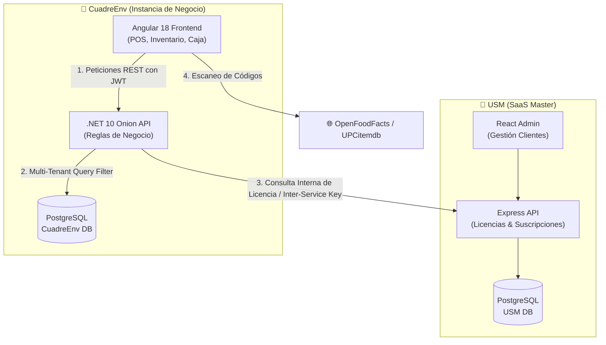

# 🏛️ Arquitectura Completa de Carpetas del Ecosistema CuadreEnv & USM

Este documento describe la estructura de directorios y la arquitectura de software de todo el ecosistema de aplicaciones:
1. **CuadreEnv Web (Frontend)** — Angular 18 (Signals, Standalone Components, CoreUI, RxJS).
2. **CuadreEnv API (Backend)** — .NET 10 bajo Arquitectura Cebolla (Clean / Onion Architecture, EF Core, PostgreSQL / Multi-tenant).
3. **USM (User & Subscription Management)** — Plataforma centralizada de autenticación, suscripciones, tenants y licencias (Express API Node.js/TypeScript + React Frontend).

---

## 1. 🌐 CuadreEnv Web (Frontend Angular)

### 📌 Resumen Tecnológico
- **Framework:** Angular 18 (Standalone Components, Signals reactivos, Control Flow `@if`, `@for`).
- **Diseño & UI:** CoreUI Free Angular Admin Template, Bootstrap 5, SCSS modular.
- **Librerías Clave:** `@zxing/browser` & `@zxing/library` (Escaneo de código de barras por cámara e imagen), RxJS, Chart.js.
- **Ruta Base:** `c:\Users\pelie\source\repos\MyDev\cuadreEnv\CuadreEnv-web`

```plaintext
CuadreEnv-web/
├── angular.json                     # Configuración del CLI de Angular y presupuestos de build
├── package.json                     # Dependencias (Angular, CoreUI, ZXing, Bootstrap)
├── tsconfig.json                    # Configuración TypeScript del compilador
├── src/
│   ├── index.html                   # HTML raíz de la aplicación
│   ├── main.ts                      # Punto de entrada / bootstrapApplication
│   ├── styles.scss                  # Estilos globales y temas
│   ├── environments/                # Variables de entorno
│   │   ├── environment.ts           # Configuración de desarrollo (API URL local)
│   │   └── environment.prod.ts      # Configuración de producción (Heroku API)
│   ├── assets/                      # Recursos estáticos (logos, imágenes, iconos SVG)
│   ├── app/                         # Núcleo y componentes compartidos globales
│   │   ├── app.component.ts         # Contenedor raíz con router-outlet
│   │   ├── app.config.ts            # Proveedores globales (HttpClient, Router, Interceptors)
│   │   ├── app.routes.ts            # Enrutador principal de la aplicación
│   │   ├── guards/                  # Guardianes de rutas
│   │   │   ├── auth.guard.ts        # Verificación de JWT activo
│   │   │   ├── module.guard.ts      # Verificación de licencias por módulo
│   │   │   └── role.guard.ts        # Control de acceso por rol (Admin, Cashier, etc.)
│   │   ├── interceptor/             # Interceptores HTTP
│   │   │   ├── auth.interceptor.ts  # Inyección de Bearer Token y X-Company-Id
│   │   │   └── error.interceptor.ts # Manejo global de errores 401, 403, 500
│   │   ├── layouts/                 # Plantillas de estructura de interfaz
│   │   │   ├── default-layout/      # Layout del sistema con Sidebar, Header y Footer
│   │   │   └── blank-layout/        # Layout limpio para Login / Pantalla completa
│   │   ├── models/                  # Interfaces y modelos de dominio TypeScript
│   │   │   ├── auth.model.ts
│   │   │   ├── movement.ts          # Encabezados y detalles de entradas/salidas de almacén
│   │   │   ├── product.model.ts
│   │   │   └── sales.model.ts
│   │   ├── services/                # Servicios transversales
│   │   │   ├── cashier.service.ts
│   │   │   └── company-context.service.ts
│   │   └── shared/                  # Componentes reutilizables en múltiples módulos
│   │       ├── components/
│   │       │   ├── camera-barcode-modal/   # Modal de cámara en vivo para escanear barras (ZXing)
│   │       │   ├── product-search/         # Buscador general/local con subida de foto y cámara
│   │       │   ├── app-product-table/      # Tabla dinámica de líneas de entrada/salida
│   │       │   ├── inventory-general-data/ # Encabezado reutilizable de movimientos
│   │       │   ├── cash-opening-modal/     # Modal de apertura rápida de turno
│   │       │   └── toast-notification/     # Sistema de alertas no bloqueantes
│   │       ├── directives/          # Directivas (formateo numérico, permisos en botones)
│   │       └── pipes/               # Pipes personalizados (moneda RD$, fechas)
│   │
│   └── features/                    # Módulos funcionales de negocio (Feature-Driven)
│       ├── approvals/               # Solicitudes de aprobación de anulaciones/gastos
│       ├── billing/                 # Facturación electrónica DGII y NCFs
│       ├── cash-register/           # Módulo de Caja (Cuadre, Arqueo, Turnos)
│       │   ├── components/
│       │   │   ├── cash-register/   # Vista de balance, desglose de denominaciones
│       │   │   └── session-detail/  # Detalle de transacciones por turno
│       │   └── services/
│       │       └── cash-register.service.ts # Apertura, cierre y cálculo de balance
│       ├── companies/               # Gestión de sucursales y datos de la empresa
│       ├── cuadreEnv/               # Núcleo de API client, traducción y tipos base
│       │   ├── services/
│       │   │   ├── apiClient.ts     # Cliente HTTP centralizado con caché y retry
│       │   │   └── notification.service.ts # Notificaciones toast
│       │   └── types/api.d.ts       # Contratos completos con el backend
│       ├── customers/               # Directorio y crédito de clientes
│       ├── dashboard/               # Métricas, KPIs de ventas y accesos rápidos
│       ├── inventory/               # Control de Inventario y Almacenes
│       │   ├── components/
│       │   │   ├── warehouse-entry/    # Entrada de almacén (búsqueda general y global)
│       │   │   ├── warehouse-outlet/   # Salida / mermas / ajustes de inventario
│       │   │   ├── warehouse-transfer/ # Traslados entre almacenes
│       │   │   └── kardex/             # Trazabilidad de movimientos por producto
│       │   └── services/
│       │       ├── warehouse.service.ts
│       │       └── stock.service.ts
│       ├── products/                # Catálogo de Productos y Servicios
│       │   ├── components/
│       │   │   ├── product-list/
│       │   │   └── product-modal/      # Creación/edición con escáner y foto
│       │   └── services/
│       │       ├── product.service.ts
│       │       └── barcode-lookup.service.ts # Consultas a OpenFoodFacts / UPCitemdb
│       ├── purchases/               # Órdenes de compra y cuentas por pagar
│       ├── sales/                   # Punto de Venta (POS) y Facturación
│       │   ├── components/
│       │   │   ├── quick-sale-page/    # POS de escritorio táctil y rápido (F2)
│       │   │   └── mobile-pos/         # POS adaptado para celulares con cámara integrada
│       │   └── services/
│       │       └── sale.service.ts
│       └── users/                   # Empleados, cajeros y roles del tenant
```

---

## 2. 🛡️ CuadreEnv API (Backend .NET 10 - Onion Architecture)

### 📌 Resumen Tecnológico
- **Framework:** .NET 10 Web API.
- **Patrón:** Onion Architecture (Clean Architecture con inversión de dependencias estricta).
- **ORM & BD:** Entity Framework Core con PostgreSQL (Supabase / AWS RDS).
- **Seguridad:** JWT Bearer multi-tenant (claims de `CompanyId`), Rate Limiting, CORS estricto.
- **Ruta Base:** `c:\Users\pelie\source\repos\MyDev\cuadreEnv\CuadreEnv-Api`

```plaintext
CuadreEnv-Api/
├── CuadreEnv-Api.sln                # Solución principal de Visual Studio / .NET
│
├── Domain/                          # CAPA 1: NÚCLEO DE DOMINIO (Sin dependencias externas)
│   ├── BaseEntity/                  # Clase base con Id, CreationDate, IsDeleted, etc.
│   ├── Company/                     # Entidades de Empresa y Sucursal
│   ├── Users/                       # Entidad User, Roles, Permisos y Tokens
│   ├── Products/                    # Product, Category, ProductType, UnitOfMeasurement
│   ├── Warehouses/                  # Warehouse, Stock, WarehouseMovement, MovementDetail
│   ├── Finance/                     # CashRegister, CashSession, CashMovement, Denomination
│   ├── Invoices/                    # Sale, SaleDetail, Payment, NcfSequence, FiscalDocument
│   ├── Credits/                     # AccountReceivable, CreditNote, PaymentSchedule
│   └── ManageRequests/              # Auditoría y aprobaciones de anulación
│
├── Onion.Common/                    # CAPA 2: SERVICIOS Y CONTRATOS COMUNES
│   ├── Authorization/               # Atributos [RequireRole], [RequirePermission], [AuthorizeModule]
│   ├── Enums/                       # Códigos de error, tipos de pago, estatus de caja
│   ├── Exceptions/                  # CustomException, HttpResponseException
│   ├── Models/                      # ApiResponse<T>, PagedResult<T>, Error
│   ├── Mvc/
│   │   └── RoutePrefixConvention.cs # Inyector automático del prefijo global "/v1"
│   └── Services/                    # ICurrentUserService, IGlobalizationService
│
├── DataAccess/                      # CAPA 3: ACCESO A DATOS (Infraestructura)
│   ├── OnionDbContext.cs            # DbContext con Query Filters globales multi-tenant
│   ├── Configurations/              # Mapeo Fluent API de entidades a tablas de PostgreSQL
│   ├── Migrations/                  # Migraciones automáticas de Entity Framework Core
│   ├── Repositories/                # Patrón Repositorio y Unit of Work
│   │   ├── Abstract/                # IRepository<T>, IUnitOfWork
│   │   └── Concrete/                # Repositorios específicos por entidad
│   ├── Tenant/
│   │   ├── JwtTenantProvider.cs     # Extracción de CompanyId del token JWT en cada request
│   │   └── AmbientTenantProvider.cs # Soporte para procesos en segundo plano
│   └── Seeds/                       # Datos iniciales (roles, tipos de productos, conceptos)
│
├── BusinessLogic/                   # CAPA 4: REGLAS DE NEGOCIO Y CASOS DE USO
│   ├── Configurations/              # Registro de inyección de dependencias (AddServices)
│   ├── Dtos/                        # Data Transfer Objects (ProductDto, SaleDto, etc.)
│   ├── Profiles/                    # Perfiles de AutoMapper
│   ├── Validators/                  # Validaciones de entrada (FluentValidation)
│   ├── HostedServices/              # Trabajos periódicos en segundo plano
│   │   └── CreditOverdueHostedService.cs # Cálculo de mora diaria en créditos
│   ├── Background/
│   │   └── FiscalOutboxWorker.cs    # Envío en cola asíncrona de comprobantes a DGII
│   └── Services/                    # Implementación de lógica de negocio
│       ├── Abstract/                # IProductService, ISaleService, ICajaService...
│       └── Concrete/
│           ├── AuthService.cs       # Autenticación, Hash PBKDF2, emisión de JWT
│           ├── CajaService.cs       # Apertura de turno, arqueo y cuadre ciego
│           ├── CashRegisterService.cs
│           ├── ProductService.cs    # CRUD de productos y cálculo de costos/márgenes
│           ├── WarehouseService.cs  # Descuento y entrada atómica de existencias
│           └── CompanyEntitlementService.cs # Validación de módulos activos con USM
│
└── crud-onion/                      # CAPA 5: API WEB Y PRESENTACIÓN (Host / Endpoints)
    ├── Program.cs                   # Configuración del pipeline HTTP, CORS, Auth y Swagger
    ├── appsettings.json             # Cadenas de conexión y configuración general
    ├── appsettings.Production.json  # Configuración para despliegue en Heroku / AWS
    ├── Hubs/
    │   └── SecurityAlertsHub.cs     # WebSocket SignalR para alertas en vivo y sincronización
    ├── Middleware/
    │   ├── ApiExceptionMiddleware.cs      # Capturador global de excepciones
    │   ├── CorrelationIdMiddleware.cs     # Trazabilidad de peticiones mediante X-Correlation-ID
    │   ├── InternalApiAuthMiddleware.cs   # Comunicación segura inter-servicios con USM
    │   ├── ActiveAccountMiddleware.cs     # Bloqueo si la suscripción está suspendida
    │   └── TenantMiddleware.cs            # Aislamiento estricto de empresa
    └── Controllers/                 # Controladores REST API
        ├── AuthController.cs              # /v1/auth (Login, Refresh, SwitchCompany)
        ├── CajaController.cs              # /v1/caja/sales (Venta rápida desde caja)
        ├── CashRegisterController.cs      # /v1/cash-register (Apertura y cierre)
        ├── ProductController.cs           # /v1/product (Catálogo, búsqueda, paginación)
        ├── SaleController.cs              # /v1/sale (Facturación y notas de crédito)
        ├── WarehouseMovementControllers.cs# /v1/warehouse-entry, outlet, transfer
        └── UserController.cs              # /v1/user (Listado de cajeros y empleados)
```

---

## 3. 🔑 USM (User & Subscription Management)

### 📌 Resumen Tecnológico
- **Propósito:** Núcleo centralizado (SaaS Master) donde se crean las organizaciones (Tenants), se facturan los planes de suscripción y se gestionan las licencias de módulos de CuadreEnv.
- **Backend:** Node.js, Express, TypeScript, Prisma ORM, PostgreSQL.
- **Frontend:** React, Vite, Tailwind CSS / UI moderna.
- **Ruta Base:** `c:\Users\pelie\source\repos\MyDev\cuadreEnv\USM`

```plaintext
USM/
├── database/                        # Scripts SQL y esquemas de base de datos de administración
├── scripts/                         # Herramientas de automatización y despliegue
│
├── express-api/                     # SERVICIO BACKEND CENTRAL DE USM
│   ├── package.json                 # Dependencias (Express, Prisma, JWT, Bcrypt)
│   ├── tsconfig.json
│   ├── prisma/
│   │   ├── schema.prisma            # Modelado de Organizations, Subscriptions, Modules, Users
│   │   └── migrations/              # Historial de migraciones Prisma
│   └── src/
│       ├── server.ts                # Inicialización del servidor Express y puerto HTTP
│       ├── config/                  # Variables de entorno y llaves secretas
│       ├── constants/               # Módulos permitidos (POS, INVENTORY, BILLING, etc.)
│       ├── types/                   # Tipos e interfaces de suscripción y usuario
│       ├── middleware/              # Autenticación de SuperAdmins y rate limiting
│       ├── services/                # Reglas de negocio SaaS
│       │   ├── organization.service.ts # Creación de nuevas empresas / tenants
│       │   ├── subscription.service.ts # Planes mensuales/anuales y expiración
│       │   ├── licensing.service.ts    # Activación/desactivación de módulos
│       │   └── token.service.ts        # Emisión de tokens maestros
│       ├── controllers/             # Controladores REST
│       │   ├── auth.controller.ts
│       │   ├── organization.controller.ts
│       │   ├── subscription.controller.ts
│       │   └── internal.controller.ts # Endpoint seguro consumido por CuadreEnv API
│       └── routes/                  # Definición de rutas Express
│           ├── auth.routes.ts
│           ├── organization.routes.ts
│           └── subscription.routes.ts
│
└── frontend-react/                  # PANEL ADMINISTRATIVO DE CONTROL SAAS (React)
    ├── package.json                 # Dependencias (React, Vite, Lucide Icons, Axios)
    ├── vite.config.ts               # Configuración del bundler Vite
    ├── index.html                   # Contenedor raíz
    └── src/
        ├── App.tsx                  # Enrutador principal de la consola de administración
        ├── main.tsx                 # Montaje en el DOM
        ├── api/                     # Cliente Axios con interceptor de token
        ├── auth/                    # Contexto de autenticación para SuperAdmins
        ├── components/              # Tablas de organizaciones, botones de cambio de plan
        ├── context/                 # Estado global de suscripciones y alertas
        ├── layouts/                 # Barra superior y navegación de USM
        ├── pages/                   # Vistas principales
        │   ├── DashboardPage.tsx    # Métricas globales de ingresos y número de clientes
        │   ├── OrganizationsPage.tsx# Lista de empresas activas con sus módulos
        │   ├── SubscriptionsPage.tsx# Control de pagos y fechas de corte
        │   └── SettingsPage.tsx     # Configuración de precios de planes
        └── utils/                   # Validaciones de formularios y formateo de monedas
```

---

## 4. 🔄 Flujo de Interacción entre Sistemas



### Reglas de Aislamiento y Roles:
1. **Multi-Tenant Estricto:** En `CuadreEnv-Api`, el `JwtTenantProvider` extrae el `CompanyId` de las credenciales firmadas. Ningún tenant puede ver o modificar registros de otro tenant.
2. **Control de Módulos (USM ➔ CuadreEnv):** Cada vez que un usuario inicia sesión en `CuadreEnv`, el sistema consulta los módulos que la empresa tiene contratados en USM. Si no tiene contratado `BILLING`, la interfaz y las APIs de facturación quedan automáticamente ocultas y protegidas con `[AuthorizeModule]`.
3. **Escáner Universal e Inventario:** En la **Entrada de Almacén**, la búsqueda es de catálogo general e internacional; si un producto no existe en el catálogo, se obtiene de bases globales y se crea en la base de datos de la empresa sin que el usuario tenga que salir de la pantalla.
